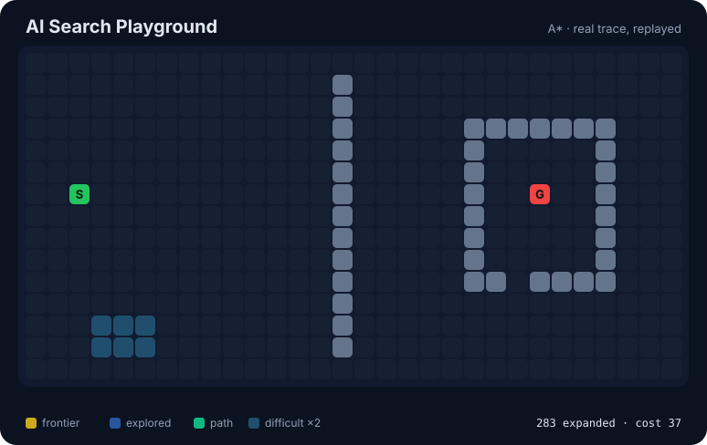
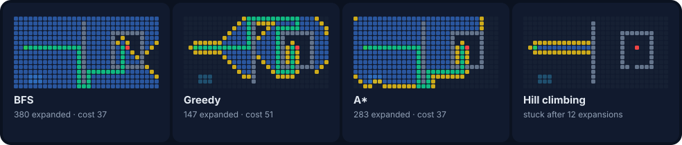

<div align="center">



# AI Search Playground

**۱۱ الگوریتم جستجوی کلاسیک هوش مصنوعی را گام‌به‌گام و روی نقشه‌ای که خودت می‌کشی ببین که چطور فکر می‌کنند.**
هر الگوریتم یک نسخه‌ی واقعی، مستقل و تست‌شده از روش کتاب درسی است و هر اجرا خودش را توضیح می‌دهد.


[English](README.md) · **فارسی**

</div>

<div dir="rtl">

---

## چه چیزی این پروژه را متفاوت می‌کند

بیشتر ابزارهای نمایش جستجو فقط یک انیمیشن قشنگ می‌کشند. این پروژه طوری ساخته شده که بتوانی به چیزی که می‌بینی **اعتماد کنی و از آن یاد بگیری**.

- **الگوریتم‌های واقعی، نه ظاهرسازی.** BFS، DFS، UCS، DLS، IDDFS، A\*، Greedy، IDA\*، Hill Climbing، Beam Search و RBFS هر کدام حلقه‌ی جستجوی مخصوص خودشان را دارند. فقط کارهای جانبی (ثبت رویدادها، بودجه‌ها، بازسازی مسیر) مشترک است.
- **هر گام ثبت می‌شود.** بک‌اند برای هر کشف، گسترش، بازگشت (backtrack)، هرس و قطع (cutoff) یک رویداد همراه با `g` و `h` و `f` می‌فرستد. رابط کاربری آن‌ها را **هم به جلو و هم به عقب** روی یک خط زمان قابل‌کشیدن پخش می‌کند.
- **هر اجرا گزارش خودش را می‌نویسد.** یک پنل زنده می‌گوید الگوریتم *همین الان* چه می‌کند، و یک خلاصه می‌گوید مسیر چطور پیدا شد، چقدر هزینه داشت و چرا. [بخش گزارش اجرا](#گزارش-اجرا) را ببین.
- **بیش از «مسیر پیدا کرد» بررسی شده.** مقایسه با Dijkstra، بررسی قابل‌قبول (admissible) و سازگار (consistent) بودن هیوریستیک، و تست *ترتیب گسترش گره‌ها* در هر الگوریتم.
- **صادق درباره‌ی محدودیت‌ها.** جستجویی که متوقف می‌شود دلیلش را می‌گوید (`max_expanded_nodes`، `depth_limit` و …). قطع شدن به‌خاطر حد عمق هرگز «مسیر وجود ندارد» گزارش نمی‌شود و کوتاه‌شدن ردیابی علامت‌گذاری می‌شود، نه اینکه بی‌صدا نتیجه را پنهان کند.
- **نقشه‌های واقع‌گرایانه.** حرکت ۴جهته یا ۸جهته (قطر √۲ هزینه دارد)، سیاست گوشه که هرگز از بین دو دیوار رد نمی‌شود، زمین با هزینه‌ی ×۲ یا ×۵، دیوارهایی که خودت می‌کشی، و شروع و هدفی که می‌کشی و جابه‌جا می‌کنی.
- **یک استقرار.** Worker پایتونی (FastAPI) و برنامه‌ی React با هم روی Cloudflare Workers می‌روند.

## تفاوت را ببین

یک نقشه، چهار الگوریتم. این‌ها وضعیت نهایی اجراهای واقعی‌اند.

<div align="center">

</div>

| الگوریتم | سلول‌های گسترش‌یافته | هزینه‌ی مسیر | چه می‌بینی |
|---|---:|---:|---|
| **BFS** | ۳۸۰ | ۳۷ | حلقه‌حلقه به بیرون پخش می‌شود. کمترین تعداد گام، ولی تقریباً همه‌چیز را کاوش می‌کند. |
| **UCS** | ۳۸۰ | ۳۷ | بهینه است؛ روی این نقشه به اندازه‌ی BFS کاوش می‌کند. |
| **A\*** | ۲۸۳ | **۳۷** | همان هزینه‌ی بهینه با حدود ۲۵٪ گسترش کمتر، با هدایت هیوریستیک. |
| **Greedy** | ۱۴۷ | ۵۱ | سریع‌ترین است و به جیب روبه‌روی هدف کشیده می‌شود: مسیری ۳۸٪ گران‌تر. |
| **DFS** | ۱۴۰ | ۱۳۳ | اول عمیق می‌رود. *یک* مسیر پیدا می‌کند ولی بسیار پیچ‌درپیچ. |
| **Beam (k = 3)** | ۱۵۸ | ۵۳ | در هر سطح سه کاندیدا نگه می‌دارد؛ هرس، بهترین مسیر را از دستش می‌گیرد. |
| **Hill climbing** | ۱۲ | ندارد | مستقیم به سمت هدف می‌رود و کنار دیوار می‌ایستد: یک بهینه‌ی محلی. |

برای بازتولید این عددها و ساختن دوباره‌ی تصویرها: `python scripts/make_readme_art.py`

## گزارش اجرا

هر اجرا یک پنل **Report** دارد. فقط از ردِ رویدادهای ثبت‌شده و شمارنده‌های خود سرور ساخته می‌شود، پس هیچ‌چیزش از پیش آماده نیست.

**تب Live: الان چه می‌کند؟** برای هر گام یک جمله‌ی ساده که مخصوص همان الگوریتمی که انتخاب کرده‌ای نوشته می‌شود، به‌علاوه‌ی شمارنده‌های زنده (گسترش‌یافته تا الان، کشف‌شده، روی مرز جستجو، بازگشت‌ها، هرس‌شده). برای A\*، دو گام پشت‌سرهم این‌طور خوانده می‌شود:

</div>

> *Expanding (6,10): it has the lowest f = g + h = 8 + 13 = 21 of all open cells (g is the cost paid, h the Manhattan distance still to go).*
>
> *Found (5,10) from (6,10) by moving up and put it in the priority queue with priority f = g + h = 9 + 14 = 23.*

<div dir="rtl">

(متن گزارش در برنامه انگلیسی است.)

**تب Summary: مسیر چطور پیدا شد؟** وقتی انیمیشن تمام شود خودش باز می‌شود. برای همین نقشه:

</div>

> **Found a path of 38 cells costing 37, after expanding 283 cells.**
>
> The straight-line lower bound (Manhattan distance) is 21, so this route costs 1.76× that. The extra comes from walls, terrain and detours.
>
> `Route: →×11 ↓×8 →×2 ↑×3 →×7 ↑×5 →`
>
> | Measure | Value |
> |---|---|
> | Cells expanded | 283 |
> | Peak priority-queue size | 59 |
> | Distinct cells expanded | 283 of 412 open (69%) |
> | Cheaper routes found | 36 |

<div dir="rtl">

گزارش با الگوریتم و نتیجه تطبیق پیدا می‌کند:

- **الگوریتم‌های تکرارشونده** (IDDFS و IDA\*) یک جدول با یک ردیف برای هر گذر می‌گیرند: حد عمق یا آستانه‌ی f، سلول‌های گسترش‌یافته و نتیجه‌ی آن گذر. **Beam search** جدولی برای هر سطح دارد: گسترش‌یافته، نگه‌داشته‌شده و هرس‌شده.
- **شکست‌ها توضیح داده می‌شوند، نه فقط گزارش.** Hill climbing می‌گوید کجا گیر کرد، چه مسیری را بالا رفته بود، و چرا این *اثبات نمی‌کند* که مسیری وجود ندارد. قطع شدن به‌خاطر حد عمق می‌گوید حد را بالا ببر. توقف به‌خاطر بودجه می‌گوید این چیزی درباره‌ی نقشه ثابت نمی‌کند.
- **زمین در نظر گرفته می‌شود.** هزینه به حرکت‌های ساده و هزینه‌ی اضافه‌ی سلول‌های سخت یا پرهزینه تفکیک می‌شود.
- با **Copy as Markdown** یا **Download .md** گزارش را مستقیم در یادداشت یا تمرینت بگذار.

## ۱۱ الگوریتم

| الگوریتم | ساختار نگهداری | بهینه | کامل |
|---|---|---|---|
| Breadth-First Search | صف FIFO | کمترین گام | بله |
| Depth-First Search | پشته‌ی LIFO + مجموعه‌ی دیده‌شده‌ها | خیر | بله، روی شبکه‌ی متناهی |
| Uniform Cost Search | صف اولویت بر اساس `g` | **بله** | بله |
| Depth-Limited Search | پشته‌ی LIFO | خیر | داخل حد عمق |
| Iterative Deepening DFS | پشته، یک گذر در هر زمان | کمترین گام | بله |
| A\* | صف اولویت بر اساس `f = g + h` | **بله** | بله |
| Greedy Best-First | صف اولویت بر اساس `h` | خیر | بله، روی شبکه‌ی متناهی |
| IDA\* | پشته‌ی بازگشتی (+ جدول هر گذر) | **بله** | بله |
| Hill Climbing | سلول فعلی | خیر | خیر |
| Beam Search | `k` کاندیدای برتر در هر سطح | خیر | خیر |
| Recursive Best-First (RBFS) | پشته‌ی بازگشتی | **بله** | بله |

هیوریستیک در شبکه‌ی ۴جهته فاصله‌ی منهتن و در شبکه‌ی ۸جهته فاصله‌ی octile است. هر دو با احتساب هزینه‌ی زمین، قابل‌قبول و سازگار بودنشان تأیید شده.

## شروع سریع

به Python 3.12+ و Node 18+ نیاز داری.

</div>

```bash
# 1. Backend API: http://localhost:8787
python -m pip install fastapi pydantic uvicorn
python -m uvicorn src.api.app:app --app-dir backend --port 8787

# 2. Frontend: http://localhost:5173 (proxies /api to the backend)
cd frontend
npm install
npm run dev
```

<div dir="rtl">

دیوار بکش، زمین رنگ کن، **S** و **G** را بکش، الگوریتم را انتخاب کن و **Run search** را بزن. با `Space` پخش/توقف و با `←` `→` گام‌به‌گام (با `Shift` ۲۵ گام).

استفاده‌ی مستقیم از API و نمونه‌ی `curl` در [`docs/api.md`](docs/api.md) و بخش انگلیسی README آمده است.

## چطور تأیید شده

تست‌ها *رفتار* را می‌سنجند، نه فقط جواب نهایی را: **۴۷۶ تست بک‌اند، ۹۷ تست واحد فرانتند و ۸ تست سراسری (end-to-end) رابط**.

- **مقایسه با مرجع.** هر الگوریتم کامل باید دقیقاً وقتی مسیر پیدا کند که مسیری وجود دارد، و UCS و A\* و IDA\* و RBFS باید روی شبکه‌های تصادفیِ وزن‌دار ۴ و ۸جهته با Dijkstra مرجع یکی باشند.
- **آنچه هر الگوریتم را تعریف می‌کند.** UCS به ترتیب `g` غیرنزولی، BFS لایه‌به‌لایه و A\* به ترتیب `f` غیرنزولی گسترش می‌دهند و A\* هرگز گرهی را که `f`اش از هزینه‌ی بهینه بیشتر است گسترش نمی‌دهد.
- **ردیابی قابل‌اعتماد.** هر رویداد با جستجو می‌خواند: `g` برابر `g` والد به‌علاوه‌ی هزینه‌ی گام است، `h` برابر هیوریستیک است، گره‌ها پیش از گسترش کشف شده‌اند و هر ردیابی با رویدادِ متناسب با نتیجه‌اش تمام می‌شود.
- **بودجه‌های دقیق.** بودجه‌ی N دقیقاً N گسترش اجازه می‌دهد، و سقف رویداد فقط ردیابی را کوتاه می‌کند، نه جستجو را.
- **پایداری عددی.** هزینه‌ها مجموع `√2`‌اند، پس مقایسه‌ها تلورانس دارند؛ وگرنه مسیرهای هم‌هزینه «ارزان‌تر» دیده می‌شوند و گره‌ها دوباره گسترش می‌یابند.
- **سراسری.** یک تست jsdom برنامه‌ی واقعی React را روی API واقعی سوار می‌کند و مثلاً بررسی می‌کند تعداد سلول‌های مسیرِ رنگ‌شده روی بوم با طول مسیر برگشتی برابر است.

</div>

```bash
python -m pip install pytest httpx && python -m pytest        # backend
cd frontend && npm test                                       # frontend
# UI end to end (needs the backend running on :8787):
E2E_API_URL=http://127.0.0.1:8787 npm run test:e2e
```

<div dir="rtl">

## استقرار روی Cloudflare Workers

Worker پایتونی هم `/api/*` و هم برنامه‌ی React ساخته‌شده را از یک origin سرو می‌کند.

| تنظیم (Workers Builds) | مقدار |
|---|---|
| Build command | `npm run build` |
| Deploy command | `npx wrangler deploy` |

فایل `wrangler.jsonc` پیش از هر استقرار `uv run pywrangler sync` را اجرا می‌کند تا وابستگی‌های پایتون بسته شوند. نام Worker در آن فایل باید با Workerی که build به آن وصل است یکی باشد. جزئیات: [`docs/cloudflare-deployment.md`](docs/cloudflare-deployment.md).

## محدودیت‌ها، با صراحت

- **الگوریتم‌های تکرارشونده و بازگشتی کار را تکرار می‌کنند.** روی ۲۸۰ نقشه‌ی تصادفیِ قابل‌حل ۲۰×۱۵ (۱۰ تا ۳۰٪ دیوار) با بودجه‌ی پیش‌فرض سرور، BFS و DFS و UCS و A\* و Greedy و IDDFS و IDA\* همه‌ی نقشه‌ها را حل کردند. RBFS ۹۴٪ را حل کرد؛ جدولی از سلول‌های دیده‌شده ندارد، پس در بقیه به بودجه‌ی گسترشش رسید و همین را گفت.
- **Hill climbing و beam search طبق تعریف ناقص‌اند.** Hill climbing راه‌اندازی مجدد تصادفی ندارد: یک راه‌اندازی مجدد از جایی غیر از سلول شروع تو شروع می‌شود، پس مسیرش مسیری از آن شروع نمی‌بود.
- **پلن رایگان Cloudflare برای هر درخواست ۱۰ms زمان CPU می‌دهد.** روی شبکه‌ی پیش‌فرض یک جستجو روی CPython ساده حدود ۱ تا ۳۰ms طول می‌کشد، آن‌هم پیش از سربار اجرای پایتون روی WebAssembly؛ پس پلن پولی را در نظر بگیر یا محدودیت‌ها را در `wrangler.jsonc` پایین بیاور.

## مستندات

[`docs/DEVELOPMENT.md`](docs/DEVELOPMENT.md) · [`docs/REPORT.md`](docs/REPORT.md) · [`docs/api.md`](docs/api.md) · [`docs/architecture.md`](docs/architecture.md) · [`docs/ALGORITHM_VALIDATION.md`](docs/ALGORITHM_VALIDATION.md) · [`docs/cloudflare-deployment.md`](docs/cloudflare-deployment.md)

## مجوز

پروژه‌ی آموزشی.

</div>
