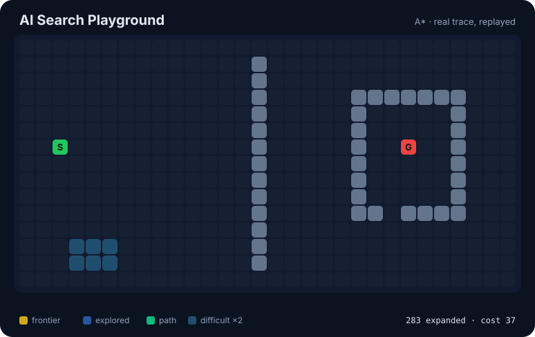
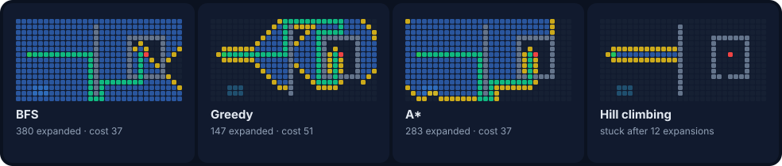
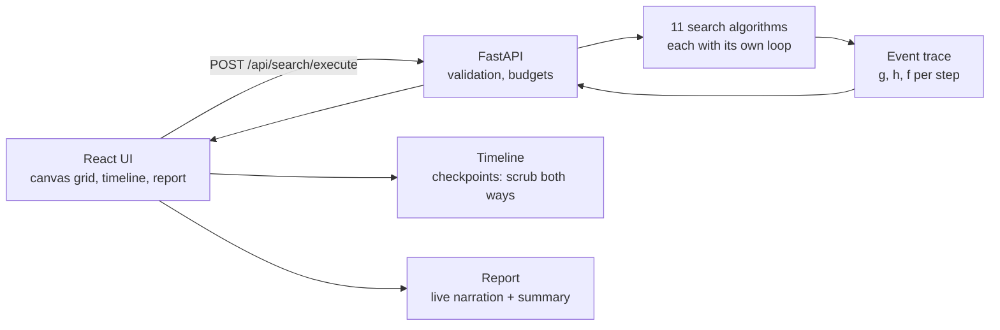

<div align="center">



# AI Search Playground

**Watch 11 classic AI search algorithms think, one step at a time, on a map you draw.**
Every algorithm is a real, independently implemented, test-verified textbook version, and every run explains itself.


**English** · [فارسی](README.fa.md)

[Why it is different](#why-it-is-different) · [See the difference](#see-the-difference) · [The run report](#the-run-report) · [Algorithms](#the-11-algorithms) · [Quick start](#quick-start) · [How it is verified](#how-it-is-verified) · [Deploy](#deploy-to-cloudflare-workers)

</div>

---

## Why it is different

Most search visualizers draw a pretty animation. This one is built so you can **trust and learn from** what you see.

- **Real algorithms, not look-alikes.** BFS, DFS, UCS, DLS, IDDFS, A\*, Greedy, IDA\*, Hill Climbing, Beam Search and RBFS each have their own search loop. They share only bookkeeping (events, budgets, path rebuilding).
- **Every step is recorded.** The backend emits an event for each discovery, expansion, backtrack, prune and cutoff, with `g`, `h` and `f`. The UI replays them forward **and backward** with a scrubbable timeline.
- **Every run writes its own report.** A live panel says what the algorithm is doing *right now*, and a summary says how the path was found, what it cost and why. See [the run report](#the-run-report).
- **Verified beyond "it found a path".** Differential tests against Dijkstra, a heuristic that is checked to be admissible and consistent, and tests of the *order* in which each algorithm expands nodes. See [how it is verified](#how-it-is-verified).
- **Honest about limits.** A search that stops tells you *why* (`max_expanded_nodes`, `depth_limit`, …). A depth cutoff is never reported as "no path", and a shortened trace is flagged instead of silently hiding the result.
- **Realistic maps.** 4-way or 8-way movement (diagonals cost √2), a corner policy that never squeezes between two walls, terrain that costs ×2 or ×5, walls you paint, and a start and goal you drag.
- **One deployment.** A Python (FastAPI) Worker and the React app ship together on Cloudflare Workers.

## See the difference

The same map, four algorithms. These are final states of real runs.

<div align="center">

</div>

| Algorithm | Cells expanded | Path cost | What you are seeing |
|---|---:|---:|---|
| **BFS** | 380 | 37 | Floods outward in rings. Fewest steps, but explores almost everything. |
| **UCS** | 380 | 37 | Optimal; on this map it explores as much as BFS. |
| **A\*** | 283 | **37** | Same optimal cost with about 25% fewer expansions, steered by the heuristic. |
| **Greedy** | 147 | 51 | Fastest, and lured into the pocket facing the goal: a 38% costlier route. |
| **DFS** | 140 | 133 | Dives first. Finds *a* path, but a very winding one. |
| **Beam (k = 3)** | 158 | 53 | Keeps three candidates per level; pruning costs it the best route. |
| **Hill climbing** | 12 | none | Walks straight at the goal and stops against the wall: a local optimum. |

Reproduce these numbers and regenerate the images with `python scripts/make_readme_art.py`.

## The run report

Every run comes with a **Report** panel. It is built only from the recorded event trace and the server's own counters, so nothing in it is canned.

**Live tab: what is it doing right now?** A plain-English sentence for every step, written for the algorithm you chose, plus live counters (expanded so far, discovered, on the frontier now, backtracks, pruned). For A\*, two consecutive steps read:

> *Expanding (6,10): it has the lowest f = g + h = 8 + 13 = 21 of all open cells (g is the cost paid, h the Manhattan distance still to go).*
>
> *Found (5,10) from (6,10) by moving up and put it in the priority queue with priority f = g + h = 9 + 14 = 23.*

**Summary tab: how did it find the path?** It opens by itself when the animation ends:

> **Found a path of 38 cells costing 37, after expanding 283 cells.**
>
> The straight-line lower bound (Manhattan distance) is 21, so this route costs 1.76× that. The extra comes from walls, terrain and detours.
>
> **How the path was found:** every cell remembers the cell it was reached from; the path is rebuilt by following those parent links from the goal back to the start.
> `Route: →×11 ↓×8 →×2 ↑×3 →×7 ↑×5 →`
>
> | Measure | Value |
> |---|---|
> | Cells expanded | 283 |
> | Peak priority-queue size | 59 |
> | Distinct cells expanded | 283 of 412 open (69%) |
> | Cheaper routes found | 36 |
>
> The largest f among expanded cells was 37, against a final cost of 37. With a consistent heuristic A\* never expands a cell whose f exceeds the optimal cost.

It also adapts to the algorithm and the outcome:

- **Iterative algorithms** (IDDFS, IDA\*) get a table with one row per pass: the depth limit or f threshold, cells expanded, and how the pass ended. **Beam search** gets a per-level table of expanded, kept and pruned.
- **Failures are explained, not just reported.** Hill climbing says where it got stuck, which route it had climbed and why that is *not* proof that no path exists. A depth cutoff says to raise the limit. A budget stop says it proves nothing about the map.
- **Terrain is accounted for.** The report breaks the cost down into plain moves and the extra paid for difficult or high-cost cells.
- **Copy as Markdown** or **download a `.md`** to drop a report straight into your notes or an assignment.

## The 11 algorithms

| Algorithm | Keeps | Optimal | Complete |
|---|---|---|---|
| Breadth-First Search | FIFO queue | fewest steps | yes |
| Depth-First Search | LIFO stack + visited set | no | yes, on a finite grid |
| Uniform Cost Search | priority queue by `g` | **yes** | yes |
| Depth-Limited Search | LIFO stack | no | within its limit |
| Iterative Deepening DFS | stack, one pass at a time | fewest steps | yes |
| A\* | priority queue by `f = g + h` | **yes** | yes |
| Greedy Best-First | priority queue by `h` | no | yes, on a finite grid |
| IDA\* | recursion stack (+ per-pass table) | **yes** | yes |
| Hill Climbing | current cell | no | no |
| Beam Search | `k` best candidates per level | no | no |
| Recursive Best-First (RBFS) | recursion stack | **yes** | yes |

The heuristic is Manhattan distance on 4-way grids and octile distance on 8-way grids. Both are verified admissible and consistent, with terrain costs included.

## Quick start

You need Python 3.12+ and Node 18+.

```bash
# 1. Backend API: http://localhost:8787
python -m pip install fastapi pydantic uvicorn
python -m uvicorn src.api.app:app --app-dir backend --port 8787

# 2. Frontend: http://localhost:5173 (proxies /api to the backend)
cd frontend
npm install
npm run dev
```

Draw walls, paint terrain, drag **S** and **G**, pick an algorithm and press **Run search**. Use `Space` to play or pause and `←` `→` to step (hold `Shift` for 25 steps).

### Use the API directly

```bash
curl -s localhost:8787/api/search/execute -H 'content-type: application/json' -d '{
  "algorithm": "astar", "rows": 5, "cols": 8,
  "start": {"row": 2, "col": 0}, "goal": {"row": 2, "col": 7},
  "obstacles": [{"row": 1, "col": 3}, {"row": 2, "col": 3}, {"row": 3, "col": 3}]
}'
```

```jsonc
{ "result": {
    "found": true, "path_cost": 11.0, "nodes_explored": 17, "termination_reason": "success",
    "path": ["(2,0)", "(2,1)", "(2,2)", "(1,2)", "(0,2)", "(0,3)", "(0,4)", "(0,5)", "(0,6)", "(0,7)", "(1,7)", "(2,7)"],
    "events": [ /* 84 events: every discovery, expansion, backtrack ... with g, h, f */ ]
} }
```

Full reference: [`docs/api.md`](docs/api.md).

## How it is verified

Tests check *behaviour*, not just final answers. There are **476 backend tests, 97 frontend unit tests and 8 end-to-end UI tests**.

- **Differential testing.** Every complete algorithm must find a path exactly when one exists, and UCS, A\*, IDA\* and RBFS must match a reference Dijkstra on random weighted 4-way and 8-way grids.
- **What defines each algorithm.** UCS expands in non-decreasing `g`, BFS level by level, A\* in non-decreasing `f`, and never a node whose `f` exceeds the optimal cost; IDA\* never expands above its threshold.
- **A trustworthy trace.** Every event agrees with the search: `g` equals the parent's `g` plus the step cost, `h` equals the heuristic, nodes are discovered before they are expanded, and every trace ends with the event that matches its outcome.
- **Exact budgets.** A budget of N allows exactly N expansions, and the event cap only shortens the trace, never the search.
- **Numerical robustness.** Costs are sums of `√2`, so comparisons use a tolerance; otherwise equal routes look "cheaper" and nodes get re-expanded.
- **End to end.** A jsdom test mounts the real React app against the real API and checks, for example, that the number of path-coloured cells on the canvas equals the length of the returned path.

```bash
python -m pip install pytest httpx && python -m pytest        # backend
cd frontend && npm test                                       # frontend
# UI end to end (needs the backend running on :8787):
E2E_API_URL=http://127.0.0.1:8787 npm run test:e2e
```

Details: [`docs/ALGORITHM_VALIDATION.md`](docs/ALGORITHM_VALIDATION.md).

## Architecture



```
backend/
  main.py             Cloudflare Worker entry point (ASGI)
  src/core/           problem model + grid (4/8-way, terrain, corner policy)
  src/algorithms/     the 11 algorithms
  src/api/            routes, schemas, validation, limits, static-asset proxy
frontend/src/
  components/         canvas Grid, Toolbar, ReportPanel, ComparisonView ...
  lib/timeline.ts     event trace -> random-access animation frames
  lib/report/         live narration + run summary
tests/                backend tests
scripts/              regenerate README art and report fixtures from real runs
```

## Deploy to Cloudflare Workers

The Python Worker serves `/api/*` and the built React app from a single origin.

| Setting (Workers Builds) | Value |
|---|---|
| Build command | `npm run build` |
| Deploy command | `npx wrangler deploy` |

`wrangler.jsonc` runs `uv run pywrangler sync` before each deploy to vendor the Python dependencies. The Worker name in that file must match the Worker the build is connected to. More in [`docs/cloudflare-deployment.md`](docs/cloudflare-deployment.md).

## Honest limits

- **Iterative and recursive algorithms repeat work.** On 280 random solvable 20×15 maps (10–30% walls) with the default server budget, BFS, DFS, UCS, A\*, Greedy, IDDFS and IDA\* solved every map. RBFS solved 94%; it keeps no table of visited cells, so on the rest it ran out of its expansion budget and said so.
- **Hill climbing and beam search are incomplete by definition.** Hill climbing has no random restarts: a restart would begin somewhere other than your start cell, so its path would not be a path from it.
- **Cloudflare's Free plan allows 10 ms of CPU per request.** On the default grid a search takes about 1–30 ms on plain CPython before the Python-on-WebAssembly overhead, so plan on the Paid plan or lower the limits in `wrangler.jsonc`.

## Docs

[`docs/DEVELOPMENT.md`](docs/DEVELOPMENT.md) · [`docs/REPORT.md`](docs/REPORT.md) · [`docs/api.md`](docs/api.md) · [`docs/architecture.md`](docs/architecture.md) · [`docs/ALGORITHM_VALIDATION.md`](docs/ALGORITHM_VALIDATION.md) · [`docs/cloudflare-deployment.md`](docs/cloudflare-deployment.md)

## License

Educational project.
